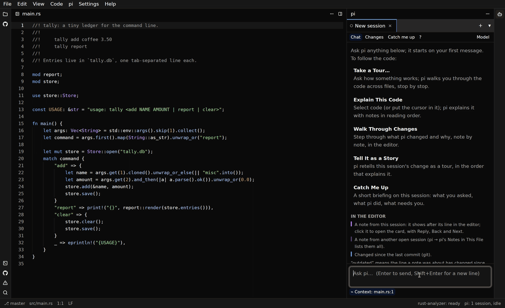
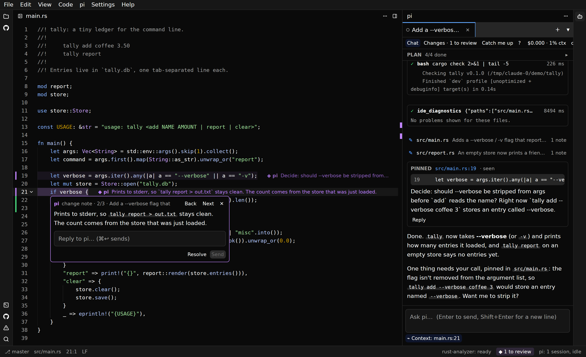
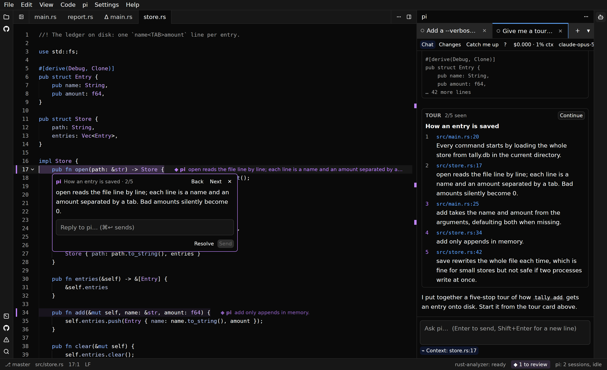
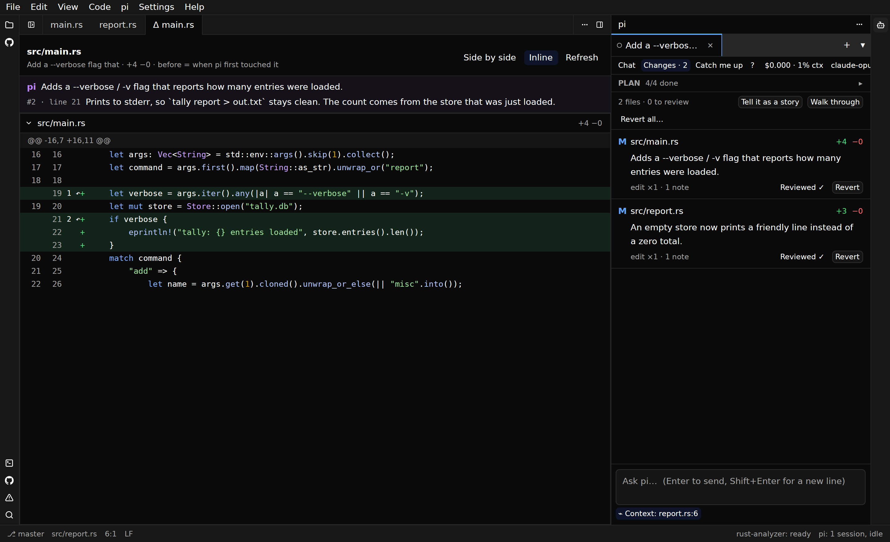
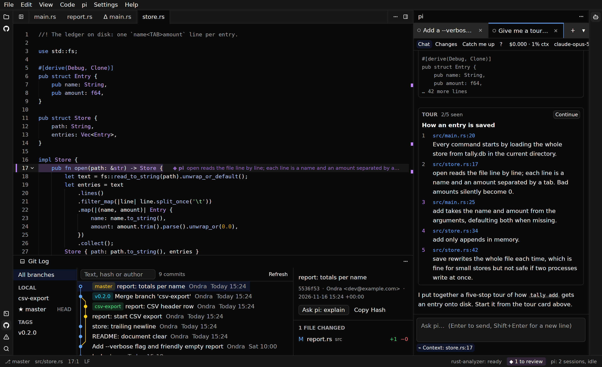

<h1 align="center">pide</h1>

<p align="center"><b>The editor for code you didn't type.</b></p>

<p align="center">
A fast, native desktop IDE built around the <a href="https://www.npmjs.com/package/@earendil-works/pi-coding-agent">pi</a> coding agent.<br>
pi writes the code. pide makes sure you still understand it.
</p>

<p align="center">
  
</p>

---

Agents now write most of the code in many projects, and the usual tools give you two choices: read
every diff in a side chat, or stop reading and hope. pide sits in between. pi's work lands **in the
code**: every change comes with a reason, every hunk with a note, and the spots that need your call
are pinned to the line. You walk through a change the way a colleague would explain it, reply on the
line you're looking at, and ask for a guided tour of anything you don't know yet.

Under that is a real IDE: language servers, git, find in files, a run panel, LaTeX with a live PDF.
It's written in Rust on [GPUI](https://www.gpui.rs/), so it is a native app, not a browser in a window.

## Follow pi's code where it lands



- **Notes in the code.** pi explains each file and each hunk it changed. The notes float over the
  code as a dim line after the code, and open into a card under the lines they're about. They take
  no width from the editor.
- **Walk through a change.** Click **◆ n to review** in the status bar. pide opens each note in
  reading order, across files, with Back and Next. Stepping past a file's last note marks it
  reviewed.
- **Pins for decisions.** When pi is unsure, it pins the line and asks. You answer in the card,
  on that line, and the reply goes to pi with the file, the line and the note attached.

## Understand code you didn't write



- **Take a Tour.** Ask "how does a session resume after a restart?". pi answers with a numbered
  tour across files, and the editor walks you through the stops.
- **Explain This Code.** Select something and pi pins 2–5 notes on it, in the order to read them.
- **Tell It as a Story.** pi retells its own change as a tour, starting from the entry point
  instead of file by file.
- **Catch Me Up.** Back after a break? A short briefing on the session: what you asked, what got
  done, what needs you, where to start.

## Work with pi, not just chat to it



- **Changes, per session.** Every file pi touched, with its reason and a diff against the version
  before pi. Revert one hunk, one file or the whole session. Edits pi makes through shell
  commands are caught too.
- Several pi sessions at once, each a thread with its own plan checklist, cost and context meter.
- The editor's context (open file, selection) goes with your message. Mention files with `@`,
  run pi's commands with `/`, paste screenshots.
- Steer pi while it works, or queue a follow-up.
- pi can read the errors your language servers report and fix them before it says it's done.
- **Ask pi** buttons on problems, run output, commits and blame lines.
- One Settings tab (Cmd+,), searchable, with Everyone / This project where it matters. Its pi pages manage pi's packages, tools, skills, MCP servers and models without touching its
  config files.

## And a proper IDE



- **Language servers**: completion, go to definition, usages, rename, quick fixes, inline errors.
  rust-analyzer, pyright and typescript-language-server out of the box, installed from inside pide.
- **Git**: gutter marks, partial commits, a log with a branch graph, blame, push and pull, branches.
  **✦ Draft with pi** writes the commit message.
- **LaTeX**: build on save, the PDF beside the source, SyncTeX both ways, errors in Problems.
- **PDF, Markdown and image previews**, find in files with replace, a run panel with clickable
  `file:line`.
- JetBrains-style shortcuts, a keymap you can rebind by typing, light and dark themes.

## Get started

pide runs on **macOS** (Apple Silicon) and **Linux** (X11 or Wayland with Vulkan). It needs Rust
1.92 or newer and the pi agent:

```sh
npm i -g @earendil-works/pi-coding-agent
git clone https://github.com/basta/pi-ide && cd pi-ide
cargo run -p pide --release --locked -- ~/your/project
```

On macOS, `dev/bundle-macos.sh` builds `pide.app` for Spotlight and the Dock.

Then press **Cmd+Shift+I** and ask pi for something. [TRY-IT.md](docs/TRY-IT.md) is a ten-minute tour
of everything above.

## Documentation

- [Try it](docs/TRY-IT.md): a ten-minute first run
- [Keyboard shortcuts](docs/KEYS.md)
- [Using pide](docs/GUIDE.md): panels, settings, previews, language servers, where files live
- [Collaborator mode](docs/COLLAB.md): how pi's notes, pins and tours work
- [Developing pide](docs/DEVELOPMENT.md) and [AGENTS.md](AGENTS.md): building, architecture, status

pide is a personal project in active development.
